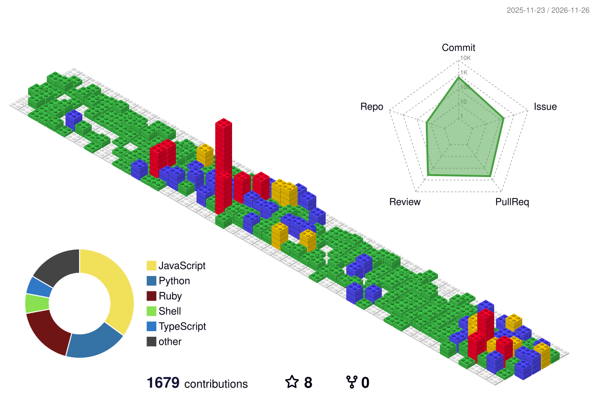

<h1 align="center">Giuseppe Luca Mareschi</h1>

<b>Software Engineer</b> · Ruby on Rails · React · TypeScript · Salvador, Brazil

  
  

---

### About me

- 💻 **5+ years** building web applications with Ruby on Rails, React, JavaScript and TypeScript
- 🏭 Today I work on an industrial software platform for process digitalization and document management, used by international enterprise clients
- ⚡ Cut processing time of data-heavy React screens from **11.5s to 3.0s (-74%)** and repeated file requests from **~347 ms to 26 ms**
- 🔧 I also take care of the infrastructure: CI/CD for 15+ repositories (a setup step went from **~8 min to 20 s**), Docker, Kubernetes and monitoring
- 🐍 I write Python for internal services and tooling
- 🤖 Shipped AI agents with RAG and MCP for enterprise customers; I use Claude Code, Codex and OpenCode every day
- 👀 Reviewed 1,038 pull requests from teammates and merged 1,000+ of my own
- 🌎 Based in Salvador, Brazil (UTC-3) · 🇧🇷 Portuguese · 🇺🇸 English (C1) · 🇮🇹 Italian (basic)

---

### Tech stack

**Backend**

  
  
  
  
  
  
  

**Frontend**

  
  
  
  
  

**Databases**

  
  
  
  

**Infrastructure & Monitoring**

  
  
  
  
  
  
  

**AI**

  
  
  

---

### Featured project

**[kpi-netdata-metabase](https://github.com/GiuseppeXD/kpi-netdata-metabase)**: sends Netdata server metrics through a Node.js proxy into ClickHouse, with KPI dashboards in Metabase. The production version collects about 200 metrics per hour.

---

### GitHub activity

> Most of my professional work lives in private repositories, so it shows up here as private contributions.

<picture>
  <source media="(prefers-color-scheme: dark)" srcset="./profile-3d-contrib/profile-night-rainbow.svg" />
  <source media="(prefers-color-scheme: light)" srcset="./profile-3d-contrib/profile-gitblock.svg" />
  
</picture>

<picture>
  <source media="(prefers-color-scheme: dark)" srcset="https://raw.githubusercontent.com/GiuseppeXD/GiuseppeXD/output/github-snake-dark.svg" />
  <source media="(prefers-color-scheme: light)" srcset="https://raw.githubusercontent.com/GiuseppeXD/GiuseppeXD/output/github-snake.svg" />
  
</picture>
